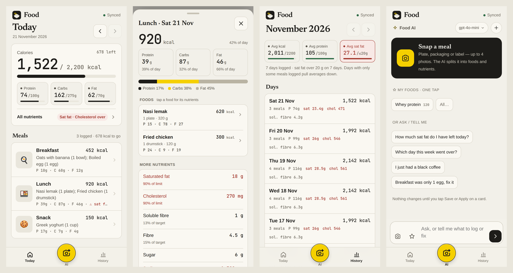

# Food log

Snap a meal → an AI model drafts the foods and nutrients → you fix what's wrong → Save.

A small, self-hosted food diary for one person. It runs as a phone web app (Add to Home Screen),
keeps everything in one SQLite file on your own machine, and works with any OpenAI-compatible model.



## Why it's built this way

- **The AI drafts, you decide.** The model only lists foods with per-item estimates. Totals are added up in
  code, not by the model, and nothing is written until you tap Save (or Apply on a chat card).
- **Fix it in plain words.** "Something off?" re-runs the estimate with your correction ("the rice was half
  that", "no sugar in the coffee") and keeps the items you didn't mention.
- **Ask about your log.** The chat can read your meals and daily totals through tools, and can *propose*
  adds/edits/deletes as cards. It can't change anything by itself.
- **Local food.** Set `"cuisine"` in `profile.json` (e.g. `"Malaysian"`, `"Japanese"`) and the estimator uses
  local dishes and serving sizes. Photos of nutrition labels override guesses.
- **Your data stays yours.** One SQLite file, a photos folder and monthly CSV exports. No account, no cloud,
  no tracking. Python standard library only: no `pip install` to run it.

Features: up to 4 photos per meal, per-food breakdown, "My foods" for one-tap repeats, macros plus sat fat,
cholesterol, fibre, soluble fibre, sugar and sodium against your own targets, month history, and background
AI jobs so a slow model survives the phone locking.

## Quick start

Needs Python 3.9+ and an API key for a model that accepts images.

```sh
git clone https://github.com/tanjinlimkelvin-dot/food-log && cd food-log
cp .env.example .env                                   # set FOOD_PASSWORD and AI_API_KEY at least
mkdir -p data && cp profile.example.json data/profile.json   # optional: about you, cuisine, daily targets
python3 server.py
```

Open http://127.0.0.1:8800 and sign in with your password.

To look around first: `FOOD_DATA_DIR=/tmp/food-demo FOOD_PASSWORD=demo python3 scripts/seed_demo.py`, then start
the server with the same two variables. It fills a throwaway folder with a week of made-up meals.

### On your phone

The server listens on `127.0.0.1` by default. To use it from your phone, put it behind HTTPS, for example:

- **Tailscale** (private, simplest): `tailscale serve --bg 8800`, then open the `https://<machine>.<tailnet>.ts.net`
  URL on the phone. You can skip the password and trust Tailscale's identity header instead (see below).
- **Caddy / nginx / Cloudflare Tunnel** with your own domain. Keep `FOOD_PASSWORD` on and set `FOOD_ORIGIN=https://your.domain`.

Then Share → Add to Home Screen.

### systemd

See `food-log.service.example`.

## Configuration

Environment variables (or a `.env` file next to `server.py`):

| Variable | Default | What |
|---|---|---|
| `FOOD_PASSWORD` | – | Sign-in password. Sessions are signed HttpOnly cookies valid 90 days; changing the password signs everyone out. |
| `FOOD_TRUST_HEADER` + `FOOD_ALLOWED_USER` | – | Alternative sign-in: accept requests whose header (e.g. `Tailscale-User-Login`) equals this user. **Only** safe when the server is reachable solely through a proxy that sets that header. |
| `AI_BASE_URL` | `https://api.openai.com/v1` | Any OpenAI-compatible endpoint: OpenAI, OpenRouter, Ollama, LiteLLM, … |
| `AI_API_KEY` | – | Key for that endpoint. Stays on the server. |
| `AI_MODEL` | `gpt-4o-mini` | Default model (must accept images for photo estimates). |
| `AI_MODELS` | from `/models` | Comma list for the model picker. |
| `FOOD_TZ` | system zone | IANA zone, e.g. `Asia/Kuala_Lumpur`. Decides what "today" is. |
| `FOOD_DATA_DIR` | `./data` | Database, photos, CSV exports, `profile.json`. |
| `FOOD_HOST` / `FOOD_PORT` | `127.0.0.1` / `8800` | Listen address. |
| `FOOD_ORIGIN` | – | Public HTTPS URL. Enables a strict Origin check and the `Secure` cookie flag. |

At least one sign-in method is required; the server refuses to start without one.

`data/profile.json` (all fields optional, see `profile.example.json`): `about` (a sentence about you that the
AI uses for context), `cuisine`, `notes` (anything the AI should keep in mind) and `targets` (daily kcal and
nutrient goals; sat fat, cholesterol and sodium are treated as limits).

## Data

| What | Where |
|---|---|
| Meals, per-food items, My foods | `data/food.db` (SQLite; tables `meals`, `meal_items`, `saved_foods`) |
| Photos | `data/photos/YYYY-MM/*.jpg`, linked to meals in `data/photos/index.json` |
| CSV export | `data/csv/YYYY-MM.csv`, rewritten from the DB after every change |

Other tools may write to the `meals` table directly; the app picks the rows up on the next load. If a meal's
totals no longer match its per-food breakdown, the breakdown is flagged as out of date instead of being
silently wrong. Back up by copying the `data` folder.

**Privacy:** photos and meal text are sent to whichever AI endpoint you configure. Use a local model
(e.g. Ollama with a vision model) if nothing should leave your machine.

## Security

- Every page and API call needs a session (or the trusted header). Only icons, fonts, the stylesheet and the sign-in page are public.
- Writes require a custom `X-Food` header (blocks cross-site form posts) and, with `FOOD_ORIGIN` set, a matching Origin.
- Strict Content-Security-Policy: no inline script, no third-party requests. Model output is escaped before display.
- Wrong passwords are slowed down and capped at 10 per 10 minutes.

Single-user by design. Don't expose it to the internet without HTTPS.

## Development

```sh
python3 tests/test_server.py      # API, auth, validation, AI-output sanitising (fake model, temp folder)
```

Browser QA (phone + desktop screenshots, overflow and console checks) is in `tests/qa_browser.py`; it needs
`pip install playwright` and runs against a demo server (instructions at the top of the file).

Layout: `server.py` (HTTP, storage, estimator, background jobs), `assistant.py` (chat tool loop),
`static/` (vanilla JS PWA, no build step).

## Credits

Fonts: [Newsreader](https://github.com/productiontype/Newsreader) and
[JetBrains Mono](https://github.com/JetBrains/JetBrainsMono), both under the SIL Open Font License 1.1.

Nutrition numbers are AI estimates for personal tracking, not medical or dietary advice.

## License

[MIT](LICENSE)
